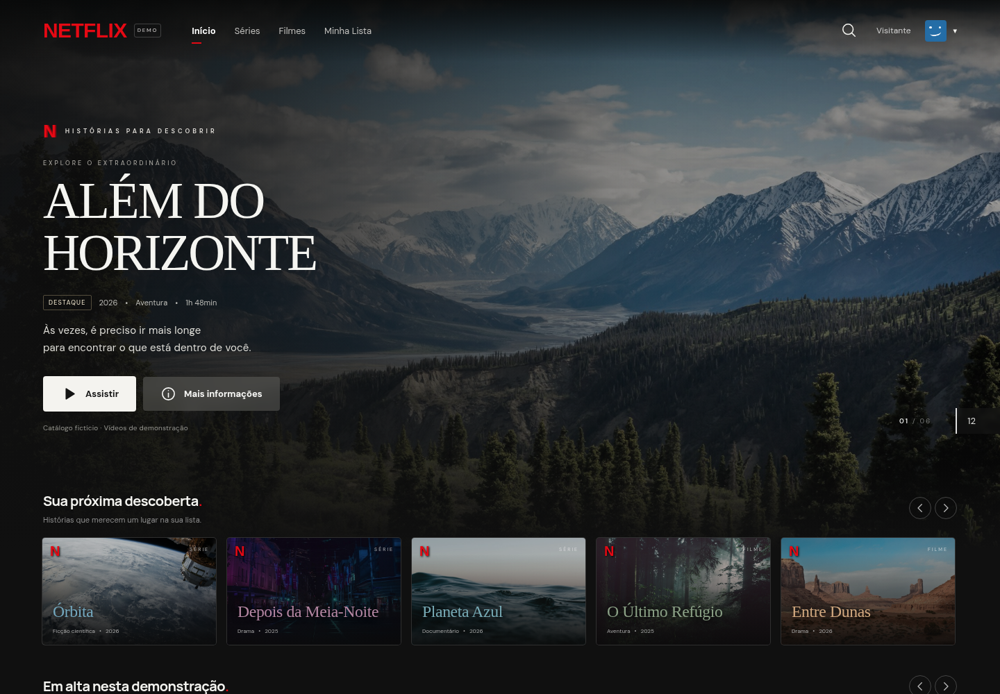

# Netflix Test — demonstração web

Uma experiência responsiva de streaming em português, com catálogo de exemplo, perfis locais, busca, Minha Lista e player com retomada de reprodução. Implementada em React + TypeScript + Vite, após análise estática do APK fornecido usando **REA 6.7.0 + JADX 0.7.1**.



## Executar

Requer Node.js 22.19+ (ou 24+) e npm.

```bash
npm ci
npm run dev
```

Abra o endereço exibido pelo Vite, normalmente `http://localhost:5173`.

```bash
npm run build       # TypeScript + build de produção em dist/
npm run preview     # Servir o build localmente
npm test            # Testes de catálogo e armazenamento
npm run test:browser # Testes completos de interface com Playwright
```

Os testes de navegador usam `/usr/bin/chromium` quando disponível. Em outros ambientes, execute `npx playwright install chromium`, ou defina `CHROMIUM_PATH` com o caminho do navegador. O Playwright inicia o servidor de testes automaticamente na porta 5173.

## O que funciona

- Navegação por início, filmes, séries e Minha Lista.
- Busca por título ou gênero, sem diferenciar acentos e maiúsculas.
- Detalhes de cada título com sinopse, metadados e identificação da mídia de demonstração.
- Três perfis com listas e progresso separados; escolha de perfil preservada entre visitas.
- Reprodução de trailers locais com controles nativos, salvamento de progresso e retomada.
- Seção Continuar assistindo para vídeos iniciados e ainda não concluídos.
- Estados vazios, tratamento de falha de mídia e continuidade em memória se o armazenamento estiver indisponível.
- Layout móvel, navegação por teclado e diálogos com foco contido/restaurado.
- Ações rápidas de assistir/salvar nos cards, acessíveis com mouse, toque e teclado.
- 64 animações finitas de entrada e microinterações, com revelação por viewport e respeito a movimento reduzido. Veja [catálogo de animações](docs/animations.md).
- Fotos e fontes locais; cards dos filmes abertos usam imagens de seus trailers.

## Organização

- `src/domain/`: modelos, busca e adaptador de persistência sem dependência de React.
- `src/data/catalog.ts`: títulos, perfis e fontes de mídia.
- `src/components/`: navegação, cards, fileiras, detalhes, perfis e player.
- `src/App.tsx`: composição da experiência e estado de navegação.
- `public/media/`: fotos e trailers de demonstração, disponíveis localmente.
- `tests/`: testes de domínio e fluxos reais no Chromium.
- `docs/analysis/`: evidências resumidas do REA e limites da análise.

O armazenamento usa `netflix-demo.library.v1` e `netflix-demo.active-profile` no `localStorage`. Os dados permanecem neste navegador; não existe conta, senha, backend ou sincronização entre dispositivos. A navegação de páginas não persiste após recarregar; listas, perfil ativo e progresso persistem.

## Mídias e limites

O catálogo contém dez títulos fictícios e dois trailers reais de filmes abertos da Blender Foundation. Títulos fictícios reproduzem um trailer de exemplo claramente identificado. Não há catálogo de filmes da Netflix, serviços de assinatura, DRM, downloads ou autenticação da Netflix. Créditos, licenças e URLs constam em [docs/media-credits.md](docs/media-credits.md).

A análise do REA identificou o pacote e classes de interface do APK. Não houve captura das telas nem execução do aplicativo Android: esta é uma reconstrução demonstrativa inspirada na estrutura observada, não uma cópia validada tela a tela. Veja [análise](docs/analysis/README.md) e [proposta aprovada](docs/web-demo-design.md).

Uma futura aplicação Android poderá compartilhar contratos e um catálogo servido por API. Componentes React de navegador não são diretamente reutilizáveis em uma interface Android nativa.

## Publicação

O build em `dist/` pode ser servido por qualquer hospedagem estática na raiz do domínio. O aplicativo não exige variáveis de ambiente nem chaves. Para hospedagem em subdiretório, é necessário ajustar o `base` do Vite e os caminhos de mídia antes de publicar.

Projeto independente, sem vínculo com a Netflix.

## Pesquisa e verificação contínua

As referências de navegação, imagens e acessibilidade estão em [docs/web-research.md](docs/web-research.md). As animações são próprias, não código copiado da Netflix.

O workflow `.github/workflows/ci.yml` executa testes de domínio, validação das animações, TypeScript, build e fluxos Chromium em cada push/PR. O teste de movimento também observa mais de 50 efeitos efetivamente iniciados durante interações reais. Não há monitoramento de produção nem promessa de ausência de erros futuros; novos casos devem virar regressões automatizadas.
